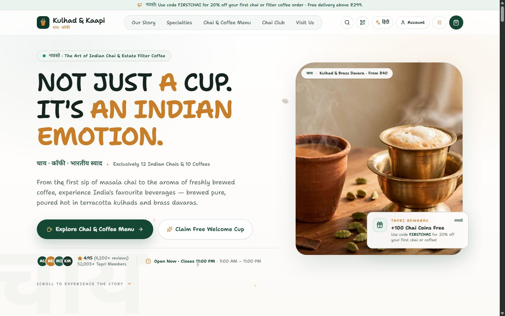
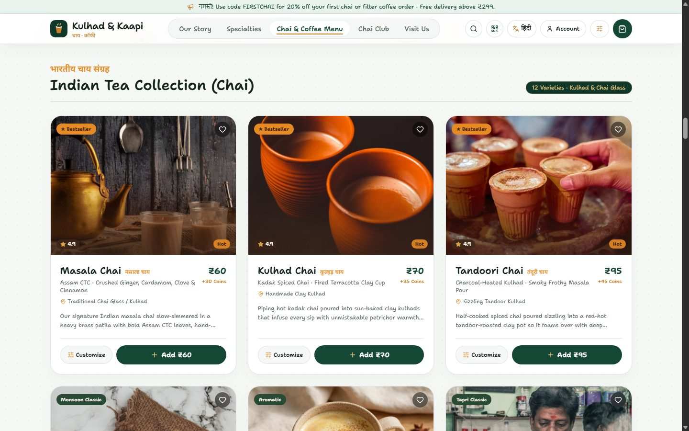
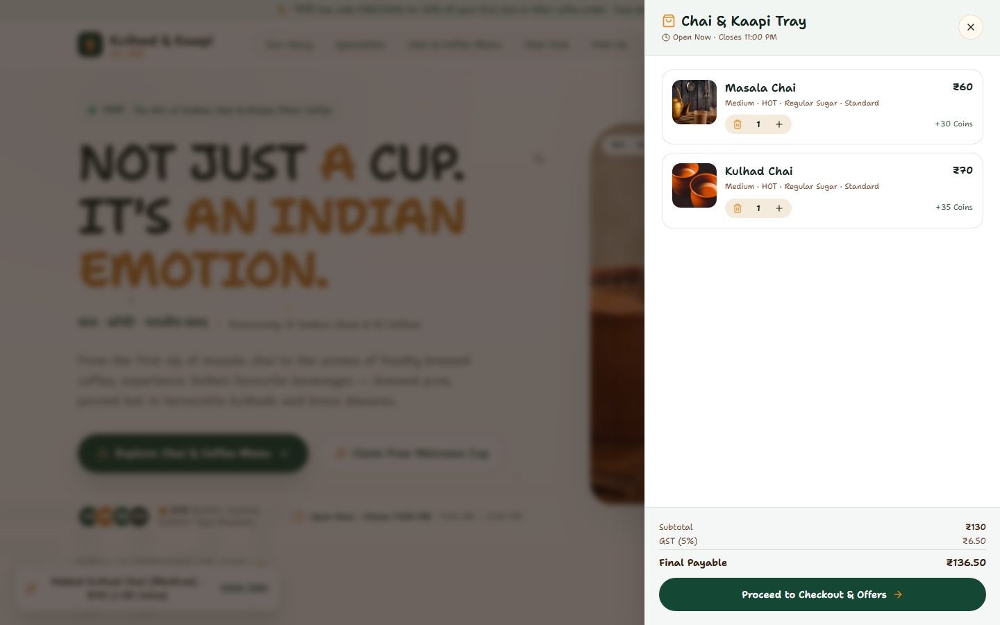
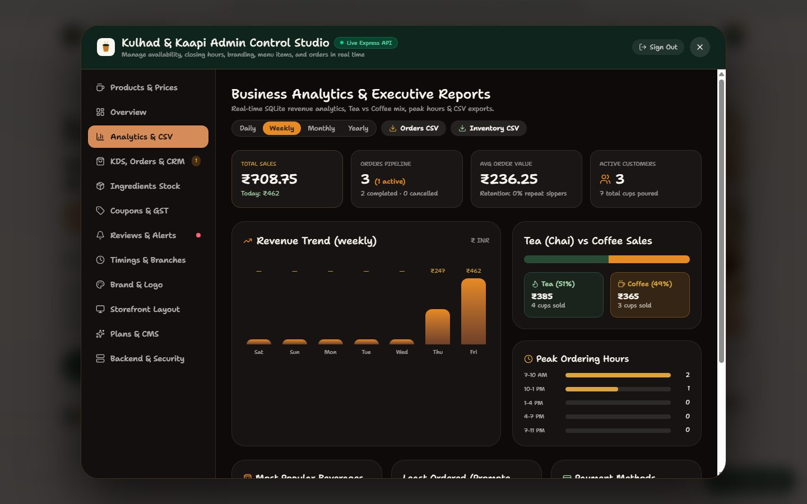
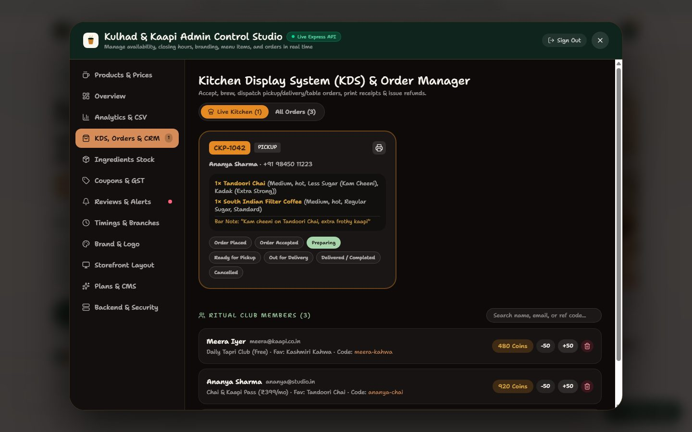
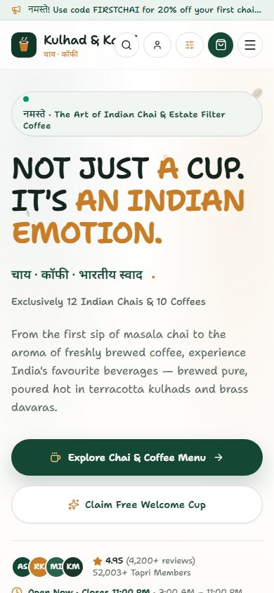
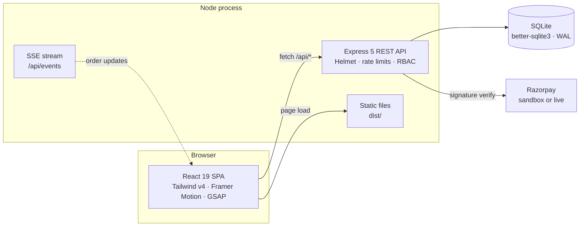

<div align="center">


<br>


**A complete storefront, live kitchen display and admin studio for an Indian tea & coffee café.**<br>
Exclusively 12 chais and 10 coffees. No food clutter.

[Quick start](#-quick-start) · [Features](#-features) · [Architecture](#-architecture) · [Configuration](#-configuration) · [API](#-api-reference) · [Deploy](#-deploying-to-production)


</div>

## ✦ Overview

Kulhad & Kaapi is a full-stack café platform that takes an order from the first tap on the menu to the moment it is handed over the counter.

- **Customers** browse a cinematic storefront, customise every cup, pay, and follow their order live.
- **Baristas** run the kitchen from a live display that updates the instant an order lands.
- **Owners** manage the menu, prices, stock, coupons, hours, branding and analytics from one dark-mode studio.

Everything runs from a single `node` process and a single SQLite file. There is nothing else to install or host.


## ✦ Screenshots

<table>
  <tr>
    <td width="50%"><br><sub><b>Storefront</b> · scroll-driven hero, bilingual copy, live open/closed status</sub></td>
    <td width="50%"><br><sub><b>Menu</b> · 22 beverages with search, filters and one-tap add</sub></td>
  </tr>
  <tr>
    <td width="50%"><br><sub><b>Order tray</b> · server-validated GST, coupons and loyalty coins</sub></td>
    <td width="50%"><br><sub><b>Admin analytics</b> · revenue trend, chai vs coffee mix, peak hours, CSV export</sub></td>
  </tr>
  <tr>
    <td width="50%"><br><sub><b>Kitchen display</b> · live orders, one-click status changes, refunds</sub></td>
    <td width="50%" align="center"><br><sub><b>Mobile</b> · fully responsive down to 390&nbsp;px</sub></td>
  </tr>
</table>


## ✦ Features

### Storefront

| | |
|---|---|
| **Bilingual** | One tap switches the whole interface between English and Hindi (हिंदी). |
| **Menu** | 12 chais and 10 coffees with hot/cold, size, sugar and strength options. |
| **Search** | `Ctrl`+`K` overlay searches by name, Hindi name or ingredient, with price and sort filters. |
| **Order tray** | Live subtotal, GST, delivery fee, coupons and loyalty-coin redemption, all priced by the server. |
| **Order types** | Pickup, delivery (address required) and dine-in with a table number. |
| **QR table menu** | Scan-to-order menu per table, with a printable table tent. |
| **Accounts** | Sign up, sign in, saved addresses, favourites, order history, password reset. |
| **Rewards** | Chai Coins loyalty and tiered membership plans. |
| **Reviews** | Verified-purchaser reviews with reporting. |
| **Support** | In-app support tickets that land in the admin inbox. |
| **Motion** | Cinematic preloader, scroll-story sections, kinetic typography, ambient particles. |

### Admin studio

Open it from the navbar or with `Ctrl`+`Shift`+`A`.

| Tab | What you can do |
|---|---|
| **Products & Prices** | Add, edit, duplicate, reorder and delete drinks. Control price, stock, visibility, sold-out state and ingredients. |
| **Overview** | Open, busy, closed or auto-schedule the shop. Set opening hours and toggle pickup orders. |
| **Analytics & CSV** | Daily, weekly, monthly and yearly revenue, chai vs coffee mix, peak hours and top drinks. Export orders and inventory as CSV. |
| **KDS, Orders & CRM** | Live kitchen display, status changes, receipts, refunds and the member list with coin adjustments. |
| **Ingredients Stock** | Ingredient levels with adjustment logs. |
| **Coupons & GST** | Percentage or flat coupons with limits, expiry, first-order and single-use rules. |
| **Reviews & Alerts** | Moderate reviews, read notifications, answer support tickets. |
| **Timings & Branches** | Hours and locations. |
| **Brand & Logo** | Change name, tagline and logo without touching code. |
| **Storefront Layout** | Choose between storefront layouts. |
| **Plans & CMS** | Edit membership plans, FAQs and testimonials. |
| **Backend & Security** | Change admin credentials and password, snapshot or factory-reset the database. |

### Platform

- **Real-time:** Server-Sent Events push order updates to the kitchen display and customers.
- **Server-side pricing:** carts are re-priced on the server, so client-sent prices are ignored.
- **Idempotent orders:** an `idempotencyKey` stops double submissions.
- **Stock-aware:** orders are rejected when a drink runs out.


## ✦ Architecture



**In development** Vite serves the UI with hot reload and proxies `/api` to Express on `:4000`.
**In production** Express serves the built `dist/` bundle and the API from one port.


## ✦ Quick start

**Requirements:** Node.js **22 or newer** and npm.

```bash
git clone https://github.com/shashankraj0205/Coffee.git
cd Coffee
npm install
npm start          # builds the frontend, then serves everything on http://localhost:4000
```

Open **http://localhost:4000**. The database is created and seeded on first run.

### Development (hot reload)

Run these in two terminals:

```bash
npm run server     # API + SQLite on http://localhost:4000
npm run dev        # Vite with hot reload (prints its URL, 5173 by default)
```

Vite proxies `/api` to the Express server, so the two terminals work together out of the box.

### Scripts

| Command | What it does |
|---|---|
| `npm run dev` | Vite dev server with hot reload |
| `npm run build` | Production build into `dist/` (single inlined `index.html`) |
| `npm run preview` | Serve the built bundle with Vite |
| `npm run server` | Start the Express API, loading `.env` if present |
| `npm start` | `build` then `server` |

### Demo accounts

These are seeded for local development only.

| Role | Email | Password |
|---|---|---|
| Admin | `admin@kulhadkaapi.in` | `chai2026` |
| Customer | `ananya@studio.in` | `chai1234` |

The admin sign-in screen shows its hint and prefills the password **only in dev builds**.

**Coupons:** `FIRSTCHAI` (20% off a first order, up to ₹60), `FESTIVAL20` (20% festival offer), `KAAPI50` (₹50 off orders of ₹220+).

### Shortcuts

| Keys | Action |
|---|---|
| `Ctrl`+`K` | Search the menu |
| `Ctrl`+`Shift`+`A` | Open the admin studio |


## ✦ Configuration

Copy `.env.example` to `.env`. `npm run server` loads it automatically.

```bash
cp .env.example .env
```

| Variable | Default | Purpose |
|---|---|---|
| `PORT` | `4000` | HTTP port |
| `NODE_ENV` | | Set to `production` when deployed |
| `AUTH_TOKEN_SECRET` | dev-only fallback | Signs auth tokens. **Required in production**: the server refuses to start without it |
| `DEFAULT_ADMIN_EMAIL` | `admin@kulhadkaapi.in` | Email of the seeded owner account |
| `DEFAULT_ADMIN_PASSWORD` | `chai2026` | Password of the seeded owner account. **Change it** |
| `SQLITE_DB_PATH` | `server/data/kulhad-kaapi.sqlite` | Database file location |
| `RAZORPAY_KEY_ID` / `RAZORPAY_KEY_SECRET` | empty | Enable live payments. Empty means sandbox |
| `RAZORPAY_WEBHOOK_SECRET` | empty | Verifies `POST /api/payments/webhook` |
| `WHATSAPP_BUSINESS_PHONE` | `+918041238900` | Number shown on the storefront |

`.env.example` also lists `APP_BASE_URL`, `FRONTEND_ORIGIN`, `DATABASE_URL`, `CLOUDINARY_*`, `SMTP_*` and `WHATSAPP_API_TOKEN`. These are placeholders for planned integrations and are **not read by the server yet**.

### Payments

With no Razorpay keys, payments run in **sandbox mode**: orders get a test gateway id and signature checks still run, so you can exercise success, failure and refund paths without charging a card. Add the three `RAZORPAY_*` variables to go live.


## ✦ Project structure

```text
.
├── server/
│   ├── index.mjs            Express app: routes, auth, orders, payments, SSE
│   ├── db.mjs               SQLite setup, password hashing, token signing, seeding
│   ├── services.mjs         Cart quoting, coupons, analytics
│   ├── seedData.mjs         First-run data (menu, coupons, members)
│   ├── migrations/          SQL schema
│   └── data/                SQLite file (git-ignored)
├── src/
│   ├── App.tsx              Page composition and keyboard shortcuts
│   ├── components/          Storefront sections, modals and admin panels
│   ├── context/             Store provider (live API with local fallback)
│   ├── services/api.ts      Typed API client
│   ├── data/                Default content and store state
│   ├── types/               Shared TypeScript types
│   └── utils/               Pricing, i18n, scheduling, image helpers
├── prisma/schema.prisma     PostgreSQL-ready schema (reference, not used at runtime)
├── public/                  Images, manifest, robots.txt, sitemap
└── docs/                    README banner and screenshots
```


## ✦ API reference

Base URL: `/api`. Admin routes need `Authorization: Bearer <token>` from `POST /api/auth/login`.

<details>
<summary><b>Public</b></summary>

| Method | Route | Purpose |
|---|---|---|
| `GET` | `/health` | Service and database status |
| `GET` | `/events` | Server-Sent Events stream |
| `GET` | `/storefront` | Catalog, coupons, reviews, hours, branding |
| `GET` | `/products/search` | Search with hot/cold, price and sort filters |
| `POST` | `/cart/quote` | Server-side subtotal, coupon, loyalty, GST and delivery |
| `POST` | `/orders` | Place an order (`cod` or `razorpay`) |
| `GET` | `/orders/:orderNumber` | Track an order |
| `POST` | `/payments/verify` | Verify a Razorpay signature |
| `POST` | `/payments/webhook` | Razorpay webhook |
| `GET` | `/reviews/:productId` | Reviews for a drink |
| `POST` | `/reviews/:id/report` | Report a review |
| `POST` | `/support` | Create a support ticket |
| `POST` | `/members` | Join the club |

</details>

<details>
<summary><b>Customer</b></summary>

| Method | Route | Purpose |
|---|---|---|
| `POST` | `/auth/register`, `/auth/customer/login` | Create an account, sign in |
| `POST` | `/auth/verify-email` | Verify email |
| `POST` | `/auth/forgot-password`, `/auth/reset-password` | Password reset |
| `GET` | `/customer/me` | Profile, orders, favourites |
| `PUT` | `/customer/profile`, `/cart` | Update profile, sync cart |
| `POST` | `/customer/addresses`, `/customer/favourites/:productId` | Addresses, favourites |
| `POST` | `/reviews` | Review a drink (verified purchasers only) |

</details>

<details>
<summary><b>Admin</b> (owner and staff roles)</summary>

| Area | Routes |
|---|---|
| Auth | `POST /auth/login`, `GET /auth/me`, `PUT /auth/credentials`, `PUT /auth/password` |
| State | `GET /admin/state`, `GET /admin/analytics`, `PUT /admin/settings`, `POST /admin/reset` |
| Menu | `POST /admin/menu`, `PUT /admin/menu/:id`, `DELETE /admin/menu/:id`, `PUT /admin/menu/reorder/list` |
| Orders | `PATCH /admin/orders/:id`, `POST /admin/orders/:id/refund`, `DELETE /admin/orders/:id` |
| Inventory | `POST /admin/inventory`, `PATCH /admin/inventory/:id/adjust` |
| Coupons | `POST /admin/coupons`, `PATCH /admin/coupons/:id`, `DELETE /admin/coupons/:id` |
| Reviews | `PATCH /admin/reviews/:id`, `DELETE /admin/reviews/:id` |
| Members | `PATCH /admin/members/:id/beans`, `PATCH /admin/members/:id/active`, `DELETE /admin/members/:id` |
| Content | `PUT /admin/pricing`, `PUT /admin/faqs`, `PUT /admin/testimonials` |
| Inbox | `PATCH /admin/support/:id`, `POST /admin/notifications/read` |

</details>


## ✦ Security

- Passwords hashed with salted **scrypt**.
- Auth tokens signed with **HMAC-SHA256**.
- **Helmet** security headers.
- **Rate limits:** 450 requests per 15 minutes for the API, 40 for auth routes.
- Admin routes require an `owner` or `staff` account.
- Cart, coupon, tax and stock checks run on the server. Client prices are ignored.
- Razorpay payment signatures are verified server-side.
- The server **refuses to start in production** on the built-in dev secret.
- The password-reset code is returned in the API response **only outside production**.


## ✦ Deploying to production

1. Set `NODE_ENV=production`.
2. Set a long random `AUTH_TOKEN_SECRET`.
3. Set `DEFAULT_ADMIN_EMAIL` and a strong `DEFAULT_ADMIN_PASSWORD` **before the first run**, since the owner account is seeded once.
4. Add the `RAZORPAY_*` keys before taking real payments.
5. Run `npm start` behind an HTTPS reverse proxy such as Caddy or Nginx.
6. Back up the SQLite file at `SQLITE_DB_PATH`.

```caddyfile
cafe.example.com {
    reverse_proxy localhost:4000
}
```

### Known limitations

- **No email or SMS delivery yet.** The password-reset flow cannot complete in production until a mail provider is connected.
- **Order numbers** use a 4-digit range (`CKP-1050` to `CKP-9849`). The server re-rolls on collision, but you should widen the range before roughly 8,800 orders.
- **Prisma / PostgreSQL** schema is provided for a future migration. The running app uses SQLite only.
- **Offline demo mode:** if the API is unreachable, the frontend falls back to browser storage so the storefront still renders. That data never reaches the server.


## ✦ Troubleshooting

| Problem | Fix |
|---|---|
| `EADDRINUSE` on port 4000 | Another process holds the port. Stop it, or set `PORT=4001`. |
| `better-sqlite3` fails to install | It compiles a native module. Use Node 22+ and make sure build tools are installed. |
| Server exits with *Set AUTH_TOKEN_SECRET* | You set `NODE_ENV=production` without a secret. Add `AUTH_TOKEN_SECRET`. |
| A drink says *Only N cups left today* | Stock ran out. Restock it in **Admin → Products & Prices**, or use **Backend & Security → Database Snapshot & Factory Reset**. |
| `429 Too Many Requests` | You hit the rate limit. Wait 15 minutes or restart the server. |
| Want a clean database | Stop the server and delete `server/data/kulhad-kaapi.sqlite*`. It reseeds on next start. |

<div align="center">


<sub>Brewed with cardamom, ginger and a little too much TypeScript.</sub>

</div>
